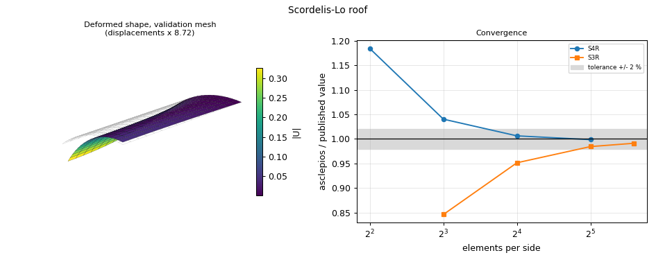

# Asclepios — an open-source finite element solver

Asclepios (`asclepios`) is a lightweight finite element solver written in C++17. It reads a subset of the Abaqus keyword
input format (`.inp`), so existing decks can run unchanged, and implements only the modules needed for
nonlinear structural dynamics of soft tissues and slender devices: explicit dynamics, static implicit
analysis, shells, beams, connectors, hyperelastic and elasto-plastic materials, and general contact.

It is a research code: small (≈ 5,300 lines), readable, and easy to modify, rather than a general-purpose
replacement for a commercial package.

## Features

| Area | Supported |
|---|---|
| Input | `*INCLUDE`, `*PARAMETER` (expressions), `*PART` / `*ASSEMBLY` / `*INSTANCE` (translation, rotation), `Assembly.Instance.set` names, `*NODE`, `*ELEMENT`, `*NSET` / `*ELSET` (GENERATE, INSTANCE, `*NSET, ELSET=`), `*SURFACE` (ELEMENT SPOS/SNEG/S1…S6, NODE, CYLINDER), `*ORIENTATION` (rectangular, LOCAL DIRECTIONS) |
| Elements | C3D8R (Flanagan-Belytschko with hourglass control), C3D8 / C3D8H (B-bar; mean dilatation for hyperelastic materials), C3D8I (incompatible modes), C3D6 (prism: 2 points in static steps, degenerate C3D8R in explicit ones), C3D4, C3D10 (quadratic tetrahedron, 4 Gauss points), C3D10M (formulated as C3D10), S4R (corotational Belytschko-Lin-Tsay), S4 (S4R kinematics with the stiffness of a physical element and output at four integration points), S3R (C0 triangle, stabilised shear), S3RS (C0 triangle, shear from the edge strains), B31 (corotational Timoshenko beam, CIRC / RECT / PIPE / BOX / I sections), B32 (quadratic Timoshenko beam, small displacements, static and implicit steps), CONN3D2 (AXIAL, CARTESIAN, JOIN, HINGE, BEAM, BUSHING; linear damping), T3D2 (truss), SPRINGA / DASHPOTA / MASS, R3D4 / R3D3 (rigid), SFM3D4R / SFM3D3 (surface elements: no stiffness, `*SURFACE SECTION` DENSITY as mass per unit area), M3D4R / M3D4 / M3D3 (membranes) |
| Materials | isotropic `*ELASTIC` (temperature-dependent rows), `*ELASTIC, TYPE=ENGINEERING CONSTANTS` (orthotropic, solids), tabulated isotropic `*PLASTIC` (J2 in 3D, plane stress and beams), linear `HARDENING=KINEMATIC` (solids), `*RATE DEPENDENT, TYPE=POWER LAW` (solids), ductile `*DAMAGE INITIATION` with `*DAMAGE EVOLUTION` (TYPE=DISPLACEMENT / ENERGY, linear softening, element deletion; solids), `*VISCOELASTIC, TIME=PRONY` on isotropic elasticity (`*ELASTIC, MODULI=LONG TERM / INSTANTANEOUS`; solids), `*EXPANSION`, `*DENSITY`, `*DAMPING` ALPHA, `*ANISOTROPIC HYPERELASTIC` FUNG-ANISOTROPIC / FUNG-ORTHOTROPIC / HOLZAPFEL (solids; fibre directions from `*ORIENTATION, LOCAL DIRECTIONS`), `*HYPERELASTIC` NEO HOOKE / MOONEY-RIVLIN / YEOH / OGDEN (Ogden: solids), superelastic shape memory alloys (material named `ABQ_SUPER_ELASTIC…` with its `*USER MATERIAL` constants; solids), linear and field-dependent tabulated `*CONNECTOR ELASTICITY`, `*CONNECTOR CONSTITUTIVE REFERENCE` |
| Sections | `*SHELL SECTION` (Simpson integration, odd number of points; OFFSET; COMPOSITE with elastic layers), `*TRANSVERSE SHEAR`, `*BEAM SECTION`, `*SOLID SECTION`, `*MEMBRANE SECTION`, `*CONNECTOR SECTION`, `*SECTION CONTROLS` (hourglass scaling, `HOURGLASS=ENHANCED`) |
| Steps | `*DYNAMIC, EXPLICIT` (NLGEOM by default; `DIRECT USER CONTROL`, `ELEMENT BY ELEMENT`, `SCALE FACTOR`), `*STATIC` (Newton-Raphson with automatic incrementation; LONG TERM), `*VISCO` (time-dependent material response), `*STATIC, RIKS` (arc length), linear perturbation steps (`*STEP, PERTURBATION` with `*STATIC`; `*FREQUENCY`, `*BUCKLE`, mode-based `*MODAL DYNAMIC` and `*STEADY STATE DYNAMICS` with `*MODAL DAMPING`), `*DYNAMIC` implicit (HHT-α: APPLICATION=MODERATE DISSIPATION, TRANSIENT FIDELITY, QUASI-STATIC, ALPHA), `*BULK VISCOSITY`, `*VARIABLE / FIXED MASS SCALING` (BELOW MIN, UNIFORM) |
| Loads | `*BOUNDARY` (displacement, velocity, acceleration, ENCASTRE…, OP=NEW), `*CLOAD` (FOLLOWER), `*DSLOAD` / `*DLOAD` P (follower pressure), `*DLOAD` GRAV, `*TEMPERATURE`, `*FIELD`, `*AMPLITUDE` (TABULAR, SMOOTH STEP, EQUALLY SPACED, PERIODIC, DECAY, step or total time), `*INITIAL CONDITIONS` (VELOCITY, TEMPERATURE, STRESS), `*TRANSFORM` (rectangular: loads and zero conditions in local axes); loads propagate between steps |
| Constraints | `*TIE` (surface ties of solid faces and shells, non-matching meshes; ADJUST, POSITION TOLERANCE, NO ROTATION), `*COUPLING` (`*KINEMATIC`, `*DISTRIBUTING` with UNIFORM / LINEAR / QUADRATIC / CUBIC weighting, constrained degrees of freedom), `*RIGID BODY` (REF NODE, ELSET, PIN / TIE NSET, ANALYTICAL SURFACE), `*EQUATION`, `*MPC` (BEAM, TIE, PIN), CONN3D2 JOIN |
| Contact | explicit general contact: `*CONTACT INCLUSIONS` (surfaces or ALL EXTERIOR), `*CONTACT EXCLUSIONS`, global `*CONTACT PROPERTY ASSIGNMENT`, Coulomb `*FRICTION`, `*SURFACE BEHAVIOR, PRESSURE-OVERCLOSURE=TABULAR / LINEAR / EXPONENTIAL` (softened); node-to-facet with rounded edges beyond the facet boundaries (free shell edges rounded within the shell), exterior faces of solid elements (C3D8R, C3D8, C3D8I, C3D4), rigid surfaces (R3D4 / R3D3 elements, analytical `*SURFACE, TYPE=CYLINDER`), surface elements, node-to-beam segment, beam-to-beam edge contact; explicit `*CONTACT PAIR` (kinematic hard contact, balanced or pure master-slave, WEIGHT) |
| Output | `*OUTPUT, FIELD` (NUMBER INTERVAL / TIME INTERVAL; FREQUENCY in static steps, ignored in explicit ones as Abaqus/Explicit does), `*OUTPUT, HISTORY` (number of intervals) |

Unknown keywords produce a single warning and are ignored.

## Build

Requirements: a C++17 compiler with OpenMP, and [Eigen](https://eigen.tuxfamily.org).
The Makefile targets macOS with Apple clang and Homebrew (`brew install libomp eigen`):

```sh
make            # builds bin/asclepios
make test       # verification suite (needs Python 3 and mpmath)
```

Paths can be overridden, for example `make OMP_DIR=/usr/local/opt/libomp EIGEN=/usr/include/eigen3`.
Other platforms need the OpenMP flags in the Makefile adjusted.

## Usage

```sh
bin/asclepios job=model cpus=8                                # reads model.inp
bin/asclepios model.inp -j 8 -o run1                          # same, job name run1
bin/asclepios job=model cpus=8 save=0.0005                    # restart file model.rst every 0.5 ms
bin/asclepios job=run2 input=model.inp restart=model.rst      # resume (same model, same binary)
```

A restart file holds the complete state (nodal fields, element states, contact, position within the explicit
step); a resumed run reproduces the uninterrupted run bit for bit. `ABQ_KEEP_RESTARTS=1` keeps one copy per
save time (`<job>_t<time>.rst`).

Output files:

- `<job>.pvd` and `<job>_vtk/*.vtu` for ParaView: U, V, RF, UR, NT11 at nodes; S_Mises, S11…S23, PEEQ,
  LE_max, STH, SF per element (shell stresses in the local shell axes: the section orientation if any, otherwise the
  projection of the global x axis on the surface, rotating with the element);
- `<job>_history.csv`: energies ALLKE, ALLIE, ALLWK, ALLVD (bulk viscosity, contact damping and Rayleigh mass
  damping), ALLPD, ALLAE, ALLDMD (0: the dissipation of damage stays in ALLIE), ALLFD, ALLMW (work of the mass added by mass scaling), ETOTAL;
- `<job>_frames.csv`: step of each frame, and mode number and eigenvalue of mode shapes;
- `<job>.sta` (progress) and `<job>.dat` (messages, eigenvalue tables).

Diagnostics on stderr: `ABQ_TRACE_NODE=Inst.123` (node state at each increment), `ABQ_TRACE_ELEM=<id>`
(shell state), `ABQ_TRACE_DT=<id>` (components of a shell's stable increment), `ABQ_CONTACT_DIAG=<n>`
(contact pairs and contact work every n increments). `ABQ_HISTORY_EVERY_INCREMENT=1` writes the energy history at every increment of
an explicit step (the `.sta` keeps the requested interval). `make elemtest` builds `bin/elemtest`; `bin/elemtest deck.inp [nl]` checks the first element of a deck: finite
difference stiffness, symmetry, eigenvalues, exact critical increment against the estimated one.
`tools/cmp_vtk.py` compares a result frame with a reference surface (legacy VTK).

## Numerical methods

- **Explicit dynamics**: central differences with half-step velocities and a lumped mass matrix. The stable
  increment is computed element by element, damping included: Δt = (2/ω)(√(1+ξ²) − ξ). Every stiffness
  (hourglass, drilling, connectors, contact) and every damping term enters this estimate. For models without
  rotational degrees of freedom, a global estimate (power iteration on M⁻¹K, K from directional derivatives of the
  internal forces, boundary conditions ignored) replaces it once converged: 0.917 times the converged estimate, kept
  only when at least 5 % above the element bound; `ELEMENT BY ELEMENT` turns it off. In models with solids and
  shells or beams, the global estimate is made on the solids alone and scales their element bound only (the shells
  and beams keep theirs); the contact frequencies of the solid nodes follow the same scaling.
  C3D8R element length: the larger of the uniform-gradient bound and a length built on the largest face
  (`*SECTION CONTROLS, IMPROVED DT METHOD`, YES by default); the initial estimate includes the linear bulk
  viscosity damping, and with initial velocities the quadratic damping at the initial compression rate; the
  reactions written at increment 0 include the linear bulk viscosity of the initial velocities (on the
  stable-increment length). Field frames are written at the end of the first increment past each output time; with
  `TIME MARKS=YES` the output times are reached exactly, the increments before each of them being made equal (the
  remainder spread over up to 10 increments). Rayleigh mass damping (`*DAMPING, ALPHA`) acts on the translations
  and on the rotations: α times the lumped mass and rotary inertia, except for beams with the default exact
  (anisotropic) rotary inertia, whose rotations are damped isotropically with ρL/2·min(I11, I22); its damping of
  the highest mode, ξ = α·Δt/4, reduces the increment.
- **C3D8R hourglass control**: Flanagan-Belytschko vectors. Explicit procedures: relaxed stiffness (`RELAX STIFFNESS`,
  the default), a standard linear solid on each mode: instantaneous stiffness 8/15·G·V·Σ|∇N|² on the current
  shape of the brick, long-term 0.1 of it, relaxation of the generalized hourglass strains with a time of 1000
  undamped stable increments of the initial element (force increments k·(Δq − 0.9·Δq_v) at the current stiffness);
  during plastic flow the force increments are scaled by max(0.1, H/(3G + H)); `HOURGLASS=STIFFNESS` keeps the
  instantaneous value. Implicit
  procedures: 0.005 G-based with a stiffness per spatial direction (sum of the squared mean gradients in that
  direction). Enhanced control (`HOURGLASS=ENHANCED`, and by default for hyperelastic materials): coupled stiffness of the 12 hourglass modes taken from the
  incompatible-mode brick (9 modes condensed, initial moduli) evaluated on the parallelepiped of the centre
  Jacobian.
- **Shells**: corotational formulation, through-thickness Simpson integration, linear bulk viscosity on membrane
  dilatation (b1·ρ·c·L_m) and curvature rates (b1·ρ·c·L_b·h²/12), with the plate wave speed c (Poisson ratio
  limited to 0.49 at fixed bulk modulus for nearly incompressible materials), L_m the element length of the stable
  increment and L_b the area over the longest midline (quadrilaterals) or the shortest edge (triangles). S4R: one-point membrane and bending; transverse shear from the covariant shear
  strains of the four edges (no shear for any Kirchhoff state), uniform part at the centre with the stiffness
  κGt/(1 + 0.25·10⁻⁴ A/t²) plus one stabilised mode (half the sum of the edge-strain variations, projected on the
  bilinear hourglass vector) and a weak stiffness 0.001·Cs/12 on their circulation; the shell director at each edge
  midpoint is the mean of the nodal normals of its two nodes, less its component along the edge (nodal normals
  averaged as Abaqus does: equal weights over the shell elements sharing the node whose normals lie within 20° of
  each other, corner normals for warped quadrilaterals), which couples the in-plane displacements and drilling
  rotations of a curved mesh to the transverse shear; hourglass stiffness of the membrane and rotation modes in Flanagan-Belytschko form
  (static: membrane 0.005 G, the documented default, rotations 0.18; explicit: instantaneous stiffnesses 0.2·G·t·A·ΣB²
  and 0.2·G·t³·A·ΣB², relaxed as for C3D8R with 500 undamped element increments), or the stiffness of an
  incompatible-mode element with `HOURGLASS=ENHANCED` (the default for hyperelastic materials; their hourglass and
  drilling stiffnesses use the initial modulus: incremental forces with a stiffness that follows the tangent would
  create energy when it changes); drilling stiffness G t A t²/(24 (t² + 0.1 A)) on the rotation
  of each corner against the spin of the bilinear field there (static) or against the mean spin of the element
  (explicit), with a warping correction. The stable increment uses the element's membrane and bending frequencies, with the tangent modulus of the outer
  section points for hyperelastic materials: membrane, the smaller of the element eigenvalue bound and
  L_m/c·(√(1 + b1²) − b1), L_m² = max(1/ΣB², 0.92·L_e²) (S3R: max(4/3/ΣB², 0.97·L_e²)), L_e from the exact one-point
  membrane eigenvalue; bending side of quadrilaterals, the larger of the uniform transverse shear (exact eigenvalue
  of its 2 × 2 mass-normalised matrix) and of the curvature, rotation hourglass and shear variation modes, which are
  orthogonal to it (thin shells: the increment does not depend on the thickness). S3R: constant membrane strain and curvature; transverse shear of the
  triangle seen as a degenerate quadrilateral whose two merged corners sit at its most isosceles vertex (homogeneous part from the covariant edge
  strains plus a shape-dependent share of their circulation, weak stiffness 0.001 on the circulation, same thin-shell
  factor and edge directors as S4R), drilling on the corner rotations (explicit: against the element spin, the first node counted twice).
  S3RS: membrane, curvature and drilling as S3R; uniform transverse shear from the three edge strains (the shear field
  whose tangential components at the edge midpoints reproduce them, one point at the centroid, no stiffness on their
  circulation); full shear stiffness k G t on thick elements (t > L/5, L the shortest edge), a penalty
  k G t · t / (2.4 L) times the thin-shell factor on thin ones.
- **Shell rotary inertia** (explicit): the same about the three axes, nodal mass times A/12 + ((L²/16)⁴ + (t²/6)⁴)^¼,
  with L the shortest edge of a triangle or the area over the longest median of a quadrilateral (the distance
  between opposite edges of a parallelogram); S3RS: nodal mass times max(A/4, t²/6); rotations do not control the
  stable increment.
- **B31 rotary inertia**: by default the lumped inertia of the half element, anisotropic and carried by the beam
  frame, ρ·L/2·(I11 + I22, I11, I22) about (axis, n1, n2) per node; the rotational equations of these nodes include
  the gyroscopic moment ω × (J·ω). `ROTARY INERTIA=ISOTROPIC`: ρ·L/2·I_max·max((2 + 3u)/(2 + u), 6u/(1 + u))
  about every axis, u = A·L²/(24·I_min), independent of the elastic constants.
- **B31 bulk viscosity** (explicit): b1·ρ·c·L on the axial strain rate and half of it on the curvature rates
  (moments 0.5·b1·ρ·c·L·I·κ̇); none on transverse shear and torsion; not included in the section force output.
- **B31 stable increment** (explicit): for the rotary inertia ρ·L/2·I_b about each bending axis, the larger of
  (2·E·I_a/L + K(I_b)·L/6)/I_rot (opposite nodal rotations, shear energy of the linear rotation field) and
  K(I_a)·L·(2/(L²·m) + 1/(2·I_rot)) (equal rotations with opposite deflections), with I_a the second moment of the
  other axis and K(I) the compensated shear stiffness of the plane of I, times 1.118; with ISOTROPIC rotary inertia
  0.99·L/c; times √(1 + b1²) − b1. This cross pairing is how Abaqus/Explicit estimates the element increment
  (free single elements: CIRC, PIPE, RECT, L/r from 0.5 to 50, two Poisson ratios: 0.2 %).
- **B31 kinematics**: section frame rotated by the mean nodal rotation, axial strain from the chord, transverse
  shear strains and forces along the rotated section directions; transverse shear stiffness k·G·A with the
  slenderness compensation 1/(1 + 0.25·L²·A/(12·I)) of each bending plane (I22 for shear along n1, I11 along
  n2); k = 0.85 for RECT, 0.89 for CIRC, 0.53 for PIPE.
- **B31 sections**: PIPE is thin-walled (A = 2πrt, I = πr³t, J = 2I on the mean radius r, section points on the
  mean radius); default section points, 8 circumferential points starting on the section axes; radially R/2 and R
  for CIRC (weights making area and second moment exact); 5 x 5 Simpson for RECT.
- **Plane-stress hyperelasticity**: Newton iteration on the thickness stretch (S33 = 0), with an exact
  derivative for the Fung model.
- **Contact**: penalty method. Each node has a frequency bound 1/Δt_e (stable increment of its stiffest element);
  a contact pair gets the frequency Ω² = max(1/(3·(1.2Δt)²), 1.1·max Ω_i²) of its nodes, nodal springs that keep each
  node stable at 1/Ω, and the softer of the slave and master springs (0.3·m/Δt² between two critical nodes,
  stiffer for light nodes of soft elements), never stiffened during a contact and shared between the contacts of
  a node; the increment is bounded by 1/Ω of the active contacts. Solid elements running under the global estimate
  of the increment (longer than their own bound by a ratio g): a slave node keeps the bound of its elements, the
  nodes of a master facet take the global one, and a contact whose frequency is set by the slave bounds the
  increment by g/Ω. The master stiffness and its sharing use the
  triangle of the facet under the contact point; the force goes to the four nodes of a quadrilateral facet with
  the bilinear weights of the point (coordinates taken on the facet of the nodes, not the one drawn in by the
  rounding of free edges). Exterior faces of solids are one-sided facets without thickness (outward normal); a node
  inside a solid contacts the face of its contact at the previous increment while it is still hit, else a face it
  crossed during the increment, else the nearest one; a node under a concave fold of the surface (a face bent into
  a valley, both triangles behind it) contacts the fold line or vertex. Beam nodes contact shell facets and beam segments; shell nodes do not contact beam
  segments, the free shell edges do (edge to segment: closest points of the two segments, edge stiffness from its
  two nodes weighted by the contact point, a vertex held by one of its edges). Normal viscous damping of 3 % of critical
  with the slave mass, or the reduced mass of the slave and of the master facet when the master side sets the
  (shared) stiffness (its dissipation is reported in ALLVD; the penalty energy only enters ETOTAL), not bounded by the spring force
  between deformable bodies (the total normal force may turn slightly tensile while a loaded contact separates fast;
  it stays compressive against rigid facets),
  shell half thickness limited to 0.3 times the smallest triangular facet height; free shell edges rounded within
  the shell (their nodes moved back into the shell plane by the half thickness, along the bisector at corners, at
  most half the facet size), so that the contact surface does not extend beyond the edge. The normal force is updated
  incrementally, so it does not jump when the stiffness changes, when a node moves to another facet, or when a contact
  is detected already penetrated. Initial overclosures are removed by a strain-free adjustment (half the
  penetration on each side, reported in the displacements). Coulomb friction (the stored tangential force is kept
  while the node stays on the same facet, either triangle of a quadrilateral). Beam segments contact each other edge to edge (closest points inside both segments, each pair once). Softened
  contact: the pressure of the overclosure acts on the tributary area of the slave node, with a weight of 0.7 per
  pass when the reverse pass is active too (a node of the master facet in contact as a slave) and 1 otherwise, as
  measured node by node in Abaqus/Explicit; its contact damping (3 % of critical) and the increment bound use the
  slope of the law. `*CONTACT EXCLUSIONS` remove the node-to-facet contacts between the two surfaces of a pair (both
  ways) and their edge contacts. Surface elements (SFM3D4R / SFM3D3) are two-sided facets without thickness whose
  nodes are slaves too; without mass (no DENSITY) they carry no contact stiffness, as in Abaqus/Explicit where such
  a crimper passes through the tube.
- **Contact pairs** (`*CONTACT PAIR`, explicit): kinematic hard contact. At the end of each increment the next one is
  predicted without contact; the slave nodes that would penetrate the master surface are put back on it by
  corrections of the current accelerations that conserve momentum (resisting force m·d/Δt² distributed to the master
  nodes with the bilinear weights of the contact point together with the slave mass, master correction = force /
  (mass + distributed slave masses), slave correction onto the corrected master surface). Between two deformable
  surfaces both passes are averaged (WEIGHT, default 0.5) and a second, unweighted correction removes the remaining
  penetration; rigid or massless surfaces are always masters. Shell surfaces are offset by the half thickness on
  their side (SPOS / SNEG). The corrections count as contact forces at the current time, as Abaqus/Explicit
  reports them (kinetic energy, reactions, contact work); impacts are plastic.
- **Constraints**: every constraint is a set of linear dependencies u_dependent = Σ c·u_independent. Implicit
  procedures eliminate the dependent degrees of freedom; explicit procedures move the forces and masses of a dependent
  node onto its independent nodes with the same coefficients (an offset mass adds its m·d² to their rotary inertia)
  and interpolate its velocity. Surface ties (`*TIE`): each slave node is paired once with the master surface;
  explicit procedures use the shape functions at the closest point of the master facet, implicit procedures dual
  mortar weights (master motion averaged over the share of the slave faces of each slave node, exact for linear
  fields); with tied rotations an offset slave node is carried rigidly (lap joints of shells). Kinematic couplings
  and rigid bodies: the coupling nodes follow the rigid motion of the reference node (the elements of a rigid body only
  carry mass). Distributing couplings: the reference node follows the translation of the weighted centroid and the
  least-squares rotation of the coupling nodes (weights: tributary areas).
- **Loads**: gravity from the lumped nodal masses; follower concentrated loads rotated with the node (rotation
  composed increment by increment); prescribed accelerations integrated into the velocities, their reactions include
  the inertia of the node, and the external work includes the kinetic energy given to prescribed nodes; temperature-dependent linear elasticity in total form, σ = C(T) (ε − α (T − T_initial)),
  so that a loaded bar lengthens when its modulus drops; initial stresses of solids released by the first step.
- **Connector stops** (`*CONNECTOR STOP`, length of AXIAL connectors, explicit): kinematic inequality constraints;
  at the end of each increment, a connector whose predicted length leaves the admissible range is brought back to
  the limit by corrections of the accelerations of its nodes along its line, shared by their masses (momentum
  conserved, prescribed dofs immobile); the arrival on a stop is a plastic impact.
- **Membranes** (M3D4R, M3D4, M3D3): the membrane part of S4R, S4 and S3R (same corotational frame, plane-stress
  materials with the thickness change, membrane hourglass control), without bending, transverse shear, drilling or
  rotational degrees of freedom; one-point quadrilaterals also control the out-of-plane hourglass mode, which no
  shear holds in a membrane: stiffness M·t·(k_xx + k_yy)/2 of the in-plane hourglass matrix k with the default
  control (relaxing like the in-plane modes), M·t·(k_xx + k_yy) with the enhanced one (the default for
  hyperelastic materials, then built on the plane-stress modulus matrix itself); hourglass relaxation time 1000
  stable increments (single M3D4R elements with prescribed hourglass motions, elastic with ν from 0 to 0.49 and
  neo-Hooke: forces within 0.03 %). M3D4 is the plain bilinear element with 2 × 2 points and the plane-stress
  modulus matrix, which locks in in-plane bending as the reference element does (no incompatible modes, unlike S4).
- **Prisms** (C3D6): static and implicit steps, two points (triangle centroid, ζ = ±1/√3) without selective
  reduction (Abaqus/Standard cantilever to 1e-5); explicit steps, the reduced-integration brick whose first node is
  doubled (nodes 1 1 2 3 4 4 5 6: uniform strain, Flanagan-Belytschko hourglass forces and their relaxation, stable
  increment of that brick) with equal nodal masses V/6 (single prisms with prescribed hourglass motions, four
  triangle shapes: forces within 0.1 %; the stable increment of an equilateral prism is 6 % smaller than the
  reference one). The global estimate of the stable increment may reach twice the element bound.
- **B32**: three nodes, quadratic interpolation, two Gauss points for every term, elastic resultants, small
  displacements and rotations (NLGEOM ignored with a warning), straight axis; lumped masses 1/6, 2/3, 1/6.
- **Beam sections BOX and I**: thin-walled formulas on the wall mid-lines (Bredt torsion constant for BOX, open
  section Σ b t³/3 for I, web of the I between the flanges), transverse shear factor 0.44, five Simpson points per
  wall (section printout of the reference solver: identical properties, I11 of the I section 0.3 % larger).
- **Shell offsets and composites**: section points shifted by the offset of the reference surface; composite
  sections integrate each layer with its own Simpson points and material (elastic layers), the quantities of the
  whole section (stable increment, transverse shear, hourglass and drilling stiffnesses, mass) use thickness
  averages of E, ν and density; the stress output of composites is the mean of the bottom and top section points.
- **Quadratic tetrahedra** (C3D10, C3D10M): 10 nodes, 4 Gauss points, diagonal mass from the consistent diagonal
  scaled to the element mass (corners 1/36, mid-edge nodes 4/27); stable increment from a Gershgorin bound of the
  element. C3D10 matches the element stiffness of the reference solver to round-off. Its C3D10M has an extra
  internal node (hourglass-controlled, with mass) and softer high modes; here it is formulated as C3D10 (static
  results within 1 %, 40 % more increments in explicit dynamics).
- **Bulk viscosity energy**: integrated with the trapezoidal rule, as the work of the element forces (a compression
  rate that changes sign every increment, the highest mode of an element, dissipates little).
- **Connectors**: CARTESIAN and BUSHING measure the position of node b in the axes that follow node a (with
  NLGEOM; without, u_b − u_a − θ_a × d), and the moment of the force pair across the offset goes to node a, so that
  the element is in equilibrium; HINGE (relative rotation about the local axis 1 only) and BEAM (rigid link) are
  linear dependencies.
- **Superelasticity** (Auricchio-Taylor): one martensite fraction, elastic moduli mixed linearly between austenite and
  martensite, Drucker-Prager loading function (tension-compression asymmetry from the start stresses), transformation
  strain along its gradient scaled to the uniaxial transformation strain, thresholds shifted with temperature; the
  fraction still to transform follows a smooth cubic step between the start and finish thresholds, from the loading
  function of the previous increment to the current one. As in Abaqus/Standard's superelastic material (measured
  increment by increment on a single element), the reverse transformation evaluates the loading function with the
  moduli of the start of the increment and returns the stress with the moduli of the mid-increment fraction, which
  makes it faster than the plain cubic step (fraction almost linear in the strain). Internal energy: elastic strain
  energy plus the transformation energy (trapezoidal in the loading function, reported as ALLPD), as Abaqus reports
  it. Explicit dynamics: the stable increment and the bulk viscosity use effective moduli of each element from its
  stress and strain increments (2μ = ΔS:Δe / Δe:Δe, 3K = Δp / Δε_mean, at least 0.1 of the austenite values,
  averaged with the previous increment), as Abaqus/Explicit does for materials without analytical moduli.
- **Viscoelasticity** (Prony series, solids): each term relaxes a strain h_i towards the elastic strain e,
  dh_i/dt = (e − h_i)/τ_i, integrated exactly over the increment for e linear in time; σ = 2G₀ dev(e − Σ g_i h_i) +
  K₀ tr(e − Σ k_i h_i) I with the instantaneous moduli (computed from the long-term ones unless
  `MODULI=INSTANTANEOUS`). `*STATIC` responds instantaneously (long-term moduli with `LONG TERM`); `*VISCO`,
  implicit and explicit dynamics use the step time. Stable increment and hourglass stiffness: instantaneous moduli.
- **Rate-dependent plasticity** (`*RATE DEPENDENT, TYPE=POWER LAW`): flow stress σ_y(ε̄ᵖ)·(1 + (ε̄̇ᵖ/D)^(1/n)) in the
  radial return, solved for x = (Δε̄ᵖ/(Δt D))^(1/n) by Newton iterations safeguarded by bisection (smooth at the
  onset of flow).
- **Ductile damage**: onset when ∫ dε̄ᵖ / ε̄ᵖ_D(η) reaches 1 (η = −p/q, table interpolated linearly), then the
  plastic displacement ū = L ε̄ᵖ (L = cube root of the element volume) drives the damage linearly, D = ū/ū_f
  (ū_f = 2G_f/σ_y at the onset for TYPE=ENERGY); σ = (1 − D) σ̄, plasticity on the effective stress σ̄. The
  element is removed when D reaches 1 at an integration point (forces and stable increment dropped, mass and
  last outputs kept).
- **Fully integrated hexahedra with hyperelastic materials** (C3D8, C3D8H): constant pressure on the element's mean
  volume change (B-bar forces). Isotropic models (neo-Hooke, Mooney-Rivlin, Yeoh, Ogden) take the isochoric
  invariants of the volume-averaged gradient F̄ = (J̄/J)^(1/3) F normalised by the point's own J, which adds a
  stiffness 5/3 μ on the variation of the volume change between the integration points: this reproduces the
  reference element stiffness matrices to round-off (single elements, regular and distorted). Fung and HGO models use
  F̄ itself. C3D8H is computed as C3D8 (constant pressure eliminated at the element level).
- **Rigid surfaces** (explicit general contact): R3D4 / R3D3 elements of a rigid body are two-sided contact facets
  without thickness; analytical surfaces (`TYPE=CYLINDER`: local x along a-b, generator along a-c, profile in the plane
  of x and y = x × generator) are cut into one-sided rigid facets (2° arcs, normal to the left of the profile
  direction) and a node coming from behind never contacts them; their contact normal is interpolated from the vertex
  normals (mean of the neighbouring facets), so that a node resting on a ridge between two facets is pushed along
  the normal of the smooth surface. Rigid facet nodes carry no mass
  and are never slaves: the penalty follows the deformable side, and the contact forces reach the reference node
  through the rigid-body constraint (its reaction and the work of its prescribed motion).
- **Orientations on shells**: the axis that follows the axis of the additional rotation in the order 1 → 2 → 3 (with
  the default rotation axis, the local 2-axis) is projected onto the surface as the material 1-direction, the
  2-direction is the normal × 1.
- **Implicit dynamics** (`*DYNAMIC`): HHT-α integration in the Newton driver, lumped masses with the physical rotary
  inertia of shells (m t²/12, not the explicit stability scaling), initial accelerations from equilibrium, mass
  proportional damping (rotations with the whole rotary inertia, beams included), loads applied at once by default (STEP), increments growing by 1.5 after each fast increment;
  the reactions are those of the HHT-weighted equilibrium, (1 + α) f(t_{n+1}) − α f(t_n), as Abaqus/Standard reports
  them.
- **Static implicit**: Newton-Raphson; element tangents by central finite differences of the internal force
  routine, so the same element code serves both procedures; each increment starts from the linear extrapolation of
  the previous one. Double precision throughout.
- **Linear perturbation procedures**: response about the base state (end of the last general step); the loads and
  boundary conditions of the step act on it only and its response is not added to the base state. Stiffness from the
  element tangents (finite differences), lumped masses with the physical rotary inertia. Eigenvalues by subspace
  iteration with Rayleigh-Ritz projection (max(2p, p + 8) vectors, shift-free factorisation of K). `*FREQUENCY`:
  mass-normalised modes. `*BUCKLE`: stress stiffness of the perturbation load from the linear response, whose
  stresses are written into the element states (scaled, restored afterwards) before the tangent is evaluated again
  at the base geometry; modes scaled to a largest displacement of 1. `*MODAL DYNAMIC`: exact integration of each
  damped modal equation for loads linear over the increment. `*STEADY STATE DYNAMICS`: modal superposition with the
  modal damping; frequency points split at the eigenfrequencies inside the range, N points per interval on a
  logarithmic scale with the bias of the reference solver; real part of the response written.
- **Arc length** (`*STATIC, RIKS`): the load factor is an unknown (loads f_base + λ (f_step − f_base)); arc length
  dl² = dλ² + |du|²/u_s² with u_s the norm of the translations of the first linear solution; predictor in the
  direction of the previous increment, corrections in the plane normal to the current increment; ends at the
  maximum load factor, at the given displacement of a node, or at the maximum number of increments.
- **Energies**: ALLIE is accumulated at the material points as Abaqus does: the work of the element forces minus
  the work of the thermal strains, and for linear elasticity with J2 plasticity the elastic strain energy plus the
  plastic work (back stress included) instead of the trapezoidal rule.

## Validation (`make validate`, `make parallel`)

292 small decks, run after every change of the solver:

- every supported element type (C3D8R, C3D8, C3D4, S4R, S3R, S3RS, B31, CONN3D2, and the other element types of the feature table) under tension, bending, torsion, shear,
  large rotations, pressure, hyperelasticity, plasticity with load reversal, thermal loads, waves, vibrations and
  rigid rotation;
- classic benchmarks of the finite element literature, compared with their published values (below);
- solver features: contact between every pair of element types, constraints, connectors, other Abaqus element types,
  loads and boundary conditions, multi-step analyses, materials, options specific to each procedure;
- every case in both procedures (implicit static or dynamic, and explicit), and parallel runs (results independent of the number of
  threads, speed-up).

Displacements, rotations, reaction forces and energy histories are compared over the whole load history: with the
closed-form solution wherever the nodal solution is known by hand (63 cases, within 0.1 %; most are exact), with
published values for the literature benchmarks (17 cases), and otherwise with reference results that each user
produces on a machine where a licence of the reference solver is available. Reference results of commercial solvers,
and comparisons with them, are not distributed with this repository.

Cases, compared quantities, tolerances and how to produce the references: [validation/README.md](validation/README.md).

### Benchmarks with published values

Refined meshes, linear static unless stated; error relative to the published converged value.

| Benchmark | Element, mesh | Quantity | Asclepios | Published | Error | Source |
|---|---|---|---|---|---|---|
| Scordelis-Lo roof | S4R, 16 × 16 | vertical displacement, middle of the free edge | 0.3043 | 0.3024 | 0.63 % | MacNeal and Harder (1985) |
| Scordelis-Lo roof | S3R, 48 × 48 × 2 | same | 0.2997 | 0.3024 | 0.89 % | MacNeal and Harder (1985) |
| Pinched cylinder with diaphragms | S4R, 32 × 32 | displacement under the load | 1.8205e-5 | 1.8248e-5 | 0.23 % | Belytschko et al. (1985) |
| Pinched hemisphere, 18° hole | S4R, 16 × 16 | displacement under the loads | 0.09383 | 0.094 | 0.18 % | MacNeal and Harder (1985) |
| Twisted beam, load along the clamped width | S4R, 24 × 4 | tip displacement | 1.7737e-3 | 1.754e-3 | 1.12 % | MacNeal and Harder (1985) |
| Twisted beam, load normal to the clamped end | S4R, 24 × 4 | tip displacement | 5.4263e-3 | 5.424e-3 | 0.04 % | MacNeal and Harder (1985) |
| Cook's membrane | S4R, 48 × 48 | vertical displacement, middle of the loaded edge | 24.30 | 23.96 | 1.42 % | Cook (1974) |
| Cook's membrane | S3R, 48 × 48 × 2 | same | 24.09 | 23.96 | 0.52 % | Cook (1974) |
| NAFEMS LE1 elliptic membrane | S4R, 48 × 24 | σyy at point D (extrapolated) | 92.19 MPa | 92.7 MPa | 0.55 % | NAFEMS (1990) |
| NAFEMS LE1 elliptic membrane | S3R, 48 × 24 × 2 | same | 93.97 MPa | 92.7 MPa | 1.36 % | NAFEMS (1990) |
| Clamped square plate, a / t = 100 | S4R, 16 × 16 | centre deflection | 0.013198 | 0.013159 | 0.29 % | Timoshenko and Woinowsky-Krieger (1959) |
| Clamped square plate, a / t = 100 | S3R, 32 × 32 × 2 | same | 0.013056 | 0.013159 | 0.78 % | Timoshenko and Woinowsky-Krieger (1959) |
| Clamped square plate, a / t = 100 | S3RS, 16 × 16 × 2 | same | 0.013238 | 0.013159 | 0.60 % | Timoshenko and Woinowsky-Krieger (1959) |
| Simply supported thick plate, a / t = 10 (Mindlin) | S3RS, 16 × 16 × 2 | centre deflection | 2.1963e-4 | 2.2219e-4 | 1.15 % | Wang, Reddy and Lee (2000) |
| Thick cylinder under internal pressure (Lamé) | C3D8R, 8 × 16 | inner / outer radial displacement | 9.0874e-3 / 5.7829e-3 | 9.0794e-3 / 5.7778e-3 | 0.09 % | Timoshenko and Goodier (1970) |
| Thick cylinder under internal pressure (Lamé) | C3D4, 16 × 32 × 6 | same | 9.0122e-3 / 5.7761e-3 | 9.0794e-3 / 5.7778e-3 | 0.74 % | Timoshenko and Goodier (1970) |
| Elastica, P L² / EI = 5 (large rotation) | B31, 40 | tip displacement across / along the beam | 71.368 / 38.700 | 71.379 / 38.763 | 0.16 % | Mattiasson (1981) |

Mesh-convergence curves and deformed shapes of every benchmark: [validation/LITERATURE.md](validation/LITERATURE.md) (`make literature`). Full references, tolerances and decks: `validation/gen_literature.py` (cases `lit_*`).



## Verification against closed-form solutions (`make test`)

| Case | Result | Reference |
|---|---|---|
| C3D8R / C3D8 bar, quasi-static explicit tension | ALLIE 0.99927 N·mm, ETOTAL/ALLWK < 1e-9 | 1.0 |
| C3D8 bar, linear static | reaction 200.000 N | 200 |
| C3D8R bar, static NLGEOM (λ = 1.1) | S11 = 19,061.6 MPa | E·ln 1.1 = 19,062 |
| S4R cantilever plate | 0.1983 mm | 0.2 (beam theory) |
| S3R cantilever plate | 0.1962 mm | 0.2 |
| B31 beam, CIRC / RECT | 0.021222 / 0.099994 mm | 0.021221 / 0.1 |
| B31 thermal expansion | −0.1000 mm | −0.1 |
| Plate impact on a fixed plate (general contact) | ETOTAL conserved to 1e-4 | energy balance |
| C3D8 bars with non-matching meshes tied (`*TIE`), uniform tension / free rigid motion | S11 = 10 MPa in every element, tip u1 exact; ALLKE kept, ALLIE = 0 | patch test; momentum |
| C3D8 bar loaded through a distributing coupling / moving with a massless kinematic reference node | S11 = 10 MPa in every element, reference node u1 exact; ALLKE kept, ALLIE = 0 | uniform traction; momentum |
| S4R sheet dropped on a rigid R3D4 plane / on a one-sided analytical cylinder from behind and from the front | ETOTAL kept, bounce; free fall through from behind, bounce from the front | energy balance; one-sided surface |
| Holzapfel-Gasser-Ogden C3D8R cube, prescribed homogeneous stretch and shear, fibres at ±30° | σ11, σ22, σ33, σ12 within 1e-6 | numerical derivative of the strain energy |
| Superelastic NiTi cube stretched to 7 % and unloaded (uniaxial stress) | plateaux and lateral strain within 1e-6 | uniaxial law integrated increment by increment |
| Fung anisotropic shell, biaxial stretch 1.15 × 1.10, S4R and S3R, material axes at 0° and 30° | σ_xx, σ_yy within 1e-6 | Fung energy differentiated with 40-digit arithmetic (mpmath) |

## Roadmap

Features exercised by the validation suite and not supported yet:

- Contact: contact in implicit procedures; contact pairs with penalty enforcement, friction or softened behaviour;
  surface-specific contact property assignments; one-sided SPOS/SNEG surfaces in general contact; analytical
  surfaces other than CYLINDER (REVOLUTION, SEGMENTS).
- Constraints: connector stops other than the length of AXIAL connectors, stops in static procedures; rigid links
  that follow large rotations exactly (the dependencies are linear in the
  rotations).
- Elements: C3D4H (the reference behaves as a continuous linear pressure field: needs nodal pressure unknowns in
  the implicit solver); the internal hourglass node of C3D10M; B32 with large displacements; layer orientations of composite
  sections; pressure loads and contact on quadratic tetrahedra.
- Loads and conditions: initial stresses in shells and beams; non-zero boundary conditions in transformed axes;
  output in transformed axes; follower loads in restart files.
- Materials: user materials (UMAT/VUMAT); viscoelasticity of hyperelastic materials; rate dependence, damage,
  viscoelasticity, Holzapfel-Gasser-Ogden and superelasticity in shells and beams; damage criteria other than
  ductile; superelasticity in explicit dynamics: Abaqus/Explicit's built-in material
  integrates the loading plateau with a result that depends on the increment size and jumps from one increment to
  the next (single element with every node driven); asclepios keeps the converged law (reactions within 6 % on the
  explicit bar).
- Procedures: direct and subspace steady-state dynamics, modal damping other than fractions of critical damping by
  mode numbers, imaginary part of harmonic responses in the output; heat transfer and coupled
  temperature-displacement procedures.

Accuracy and performance:

- Shells: drilling rotations and element stresses of static in-plane problems; transverse shear of strongly distorted
  quadrilaterals and of non-isosceles triangles (Abaqus adds the circulation of the edge strains to the homogeneous
  shear with coefficients of the geometry: approximated for triangles, not reproduced for quadrilaterals; 1 to 5 %
  on the rotation terms of a single distorted element).
- Dynamics: beam-to-solid impact (displacements within 11 %, stresses 15 %: the impact lasts 5 increments and the
  B31 stable increment differs by 2e-4, which shifts the phase of the contact; the response matches once the
  increments coincide); stable increment of B31 elements within 4e-4 (2e-4 near the crossing of the bending and
  shear modes), prescribed transverse shear stiffness ignored in it; beam-to-shell impact
  (reactions within 14 %, energy 6 %, beam end rotations 13 %); a shell sheet dropped
  on a beam stops like the reference at the first contact increment, then its contact force stays up to 25 % lower; self-contact of a coiled strip (first contact within 7 %; the later chatter of the coil on the clamped edge, which
  goes straight into the reactions, is not compared); thin Fung leaflets flapping under pressure (valve model: same response up to 2.4 ms, then the corner next to the
  clamped annulus and the later flapping differ).
- Performance: vectorisation of the constitutive updates; parallel linear solver for the implicit procedure (speed-up
  1.4 on 8 threads); fewer threads on small models (OpenMP overhead).

## Relationship with Abaqus

Asclepios is not affiliated with, endorsed by or connected to Dassault Systèmes. Abaqus is a trademark of
Dassault Systèmes or its subsidiaries. Asclepios is an independent implementation and contains no Abaqus code.
It reads a subset of the Abaqus input format so that existing models can be run.

## Support and professional services

Questions and bug reports: GitHub issues. Product-specific simulations and custom validation studies can be
arranged: see [SUPPORT.md](SUPPORT.md).

## Citing

If you use Asclepios in published work, please cite it: [CITATION.cff](CITATION.cff) (GitHub button "Cite this
repository").

## License

Copyright 2026 NonameAccountMax. Licensed under the Apache License, Version 2.0: see [LICENSE](LICENSE) and
[NOTICE](NOTICE).
