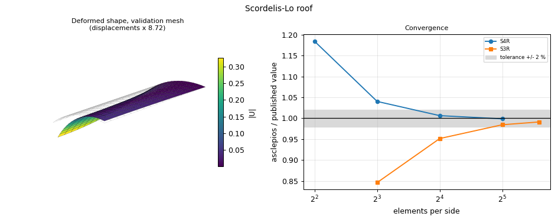
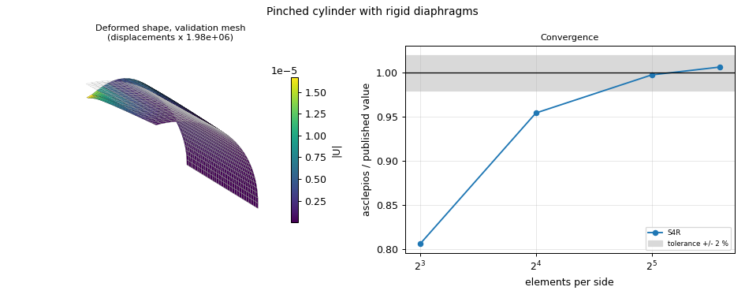
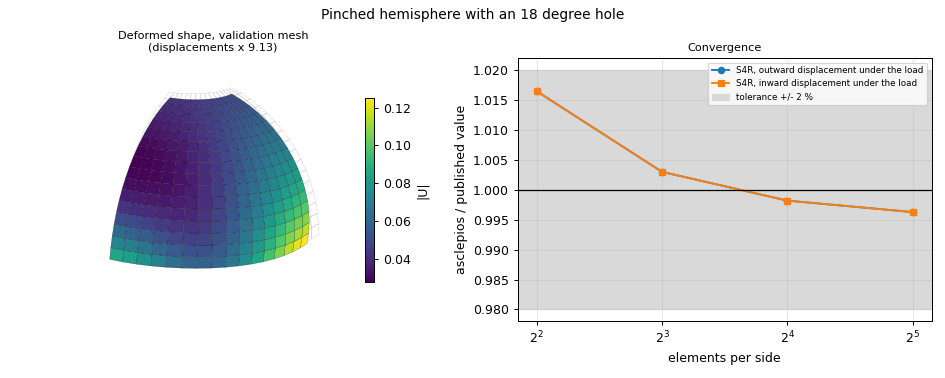
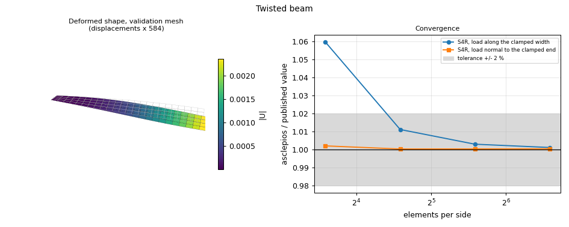
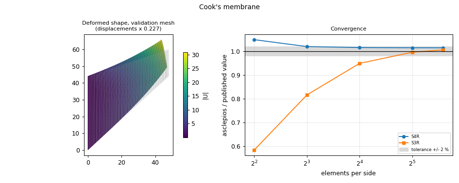
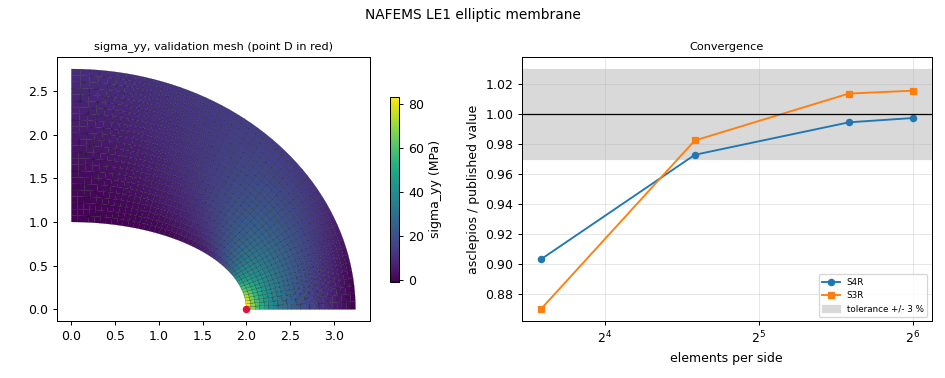
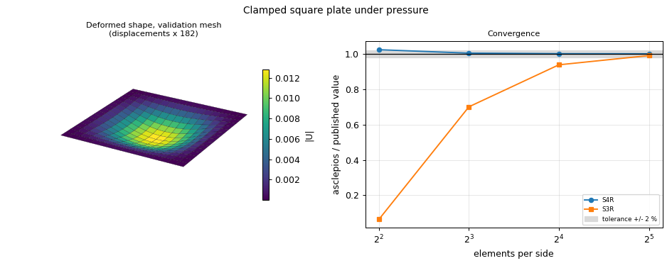
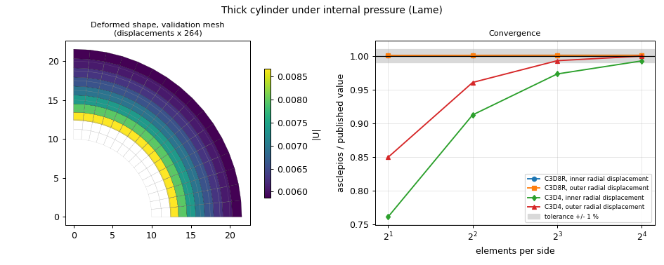
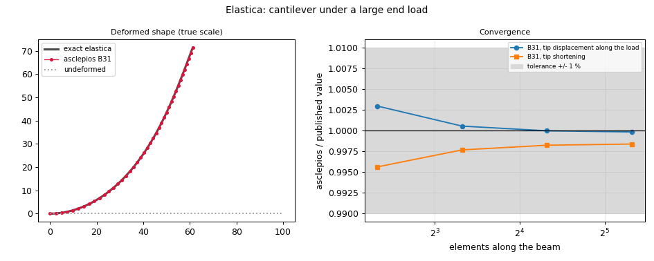

# Published benchmarks

Generated by `validation/literature.py` (`make literature`). Classic benchmarks of the finite element literature, run with asclepios on series of meshes and compared with the converged value of the cited publication. Left: deformed shape (or stress) of the mesh used in the validation suite (`make validate`, cases `lit_*`); right: result divided by the published value against the mesh density, with the tolerance of the validation case. Decks: `validation/gen_literature.py`.

## Scordelis-Lo roof

Source: MacNeal and Harder (1985), Finite Elem. Anal. Des. 1:3-20: 0.3024.

| Element | Mesh | Quantity | asclepios | Published | Error |
|---|---|---|---|---|---|
| S4R | 4 | w at the middle of the free edge | 0.35812 | 0.3024 | 18.43 % |
| S4R | 8 | w at the middle of the free edge | 0.31459 | 0.3024 | 4.03 % |
| S4R | 16 | w at the middle of the free edge | 0.3043 | 0.3024 | 0.63 % |
| S4R | 32 | w at the middle of the free edge | 0.30197 | 0.3024 | 0.14 % |
| S3R | 8 | w at the middle of the free edge | 0.2558 | 0.3024 | 15.41 % |
| S3R | 16 | w at the middle of the free edge | 0.28768 | 0.3024 | 4.87 % |
| S3R | 32 | w at the middle of the free edge | 0.29768 | 0.3024 | 1.56 % |
| S3R | 48 | w at the middle of the free edge | 0.2997 | 0.3024 | 0.89 % |

## Pinched cylinder with rigid diaphragms

Source: Belytschko et al. (1985), Comput. Methods Appl. Mech. Engrg. 51:221-258: 1.8248e-5.

| Element | Mesh | Quantity | asclepios | Published | Error |
|---|---|---|---|---|---|
| S4R | 8 | displacement under the load | 1.4698e-05 | 1.8248e-05 | 19.45 % |
| S4R | 16 | displacement under the load | 1.7415e-05 | 1.8248e-05 | 4.56 % |
| S4R | 32 | displacement under the load | 1.8205e-05 | 1.8248e-05 | 0.23 % |
| S4R | 48 | displacement under the load | 1.8367e-05 | 1.8248e-05 | 0.65 % |

## Pinched hemisphere with an 18 degree hole

Source: MacNeal and Harder (1985), Finite Elem. Anal. Des. 1:3-20: 0.094.

| Element | Mesh | Quantity | asclepios | Published | Error |
|---|---|---|---|---|---|
| S4R | 4 | outward displacement under the load | 0.095549 | 0.094 | 1.65 % |
| S4R | 4 | inward displacement under the load | 0.095549 | 0.094 | 1.65 % |
| S4R | 8 | outward displacement under the load | 0.094282 | 0.094 | 0.30 % |
| S4R | 8 | inward displacement under the load | 0.094282 | 0.094 | 0.30 % |
| S4R | 16 | outward displacement under the load | 0.093829 | 0.094 | 0.18 % |
| S4R | 16 | inward displacement under the load | 0.093829 | 0.094 | 0.18 % |
| S4R | 32 | outward displacement under the load | 0.093649 | 0.094 | 0.37 % |
| S4R | 32 | inward displacement under the load | 0.093649 | 0.094 | 0.37 % |

## Twisted beam

Source: MacNeal and Harder (1985), Finite Elem. Anal. Des. 1:3-20: 0.005424.

| Element | Mesh | Quantity | asclepios | Published | Error |
|---|---|---|---|---|---|
| S4R, load along the clamped width | 12 x 2 | tip displacement | 0.0018587 | 0.001754 | 5.97 % |
| S4R, load along the clamped width | 24 x 4 | tip displacement | 0.0017737 | 0.001754 | 1.12 % |
| S4R, load along the clamped width | 48 x 8 | tip displacement | 0.0017594 | 0.001754 | 0.31 % |
| S4R, load along the clamped width | 96 x 16 | tip displacement | 0.0017562 | 0.001754 | 0.13 % |
| S4R, load normal to the clamped end | 12 x 2 | tip displacement | 0.0054357 | 0.005424 | 0.22 % |
| S4R, load normal to the clamped end | 24 x 4 | tip displacement | 0.0054263 | 0.005424 | 0.04 % |
| S4R, load normal to the clamped end | 48 x 8 | tip displacement | 0.0054265 | 0.005424 | 0.05 % |
| S4R, load normal to the clamped end | 96 x 16 | tip displacement | 0.0054269 | 0.005424 | 0.05 % |

## Cook's membrane

Source: Cook (1974), J. Struct. Div. ASCE 100:1851-1863; converged value 23.96 at the middle of the loaded edge.

| Element | Mesh | Quantity | asclepios | Published | Error |
|---|---|---|---|---|---|
| S4R | 4 | vertical displacement of the middle of the loaded edge | 25.12 | 23.96 | 4.84 % |
| S4R | 8 | vertical displacement of the middle of the loaded edge | 24.422 | 23.96 | 1.93 % |
| S4R | 16 | vertical displacement of the middle of the loaded edge | 24.322 | 23.96 | 1.51 % |
| S4R | 32 | vertical displacement of the middle of the loaded edge | 24.304 | 23.96 | 1.44 % |
| S4R | 48 | vertical displacement of the middle of the loaded edge | 24.301 | 23.96 | 1.42 % |
| S3R | 4 | vertical displacement of the middle of the loaded edge | 13.964 | 23.96 | 41.72 % |
| S3R | 8 | vertical displacement of the middle of the loaded edge | 19.531 | 23.96 | 18.48 % |
| S3R | 16 | vertical displacement of the middle of the loaded edge | 22.719 | 23.96 | 5.18 % |
| S3R | 32 | vertical displacement of the middle of the loaded edge | 23.849 | 23.96 | 0.46 % |
| S3R | 48 | vertical displacement of the middle of the loaded edge | 24.085 | 23.96 | 0.52 % |

## NAFEMS LE1 elliptic membrane

Source: NAFEMS (1990), The Standard NAFEMS Benchmarks, test LE1: 92.7 MPa.

| Element | Mesh | Quantity | asclepios | Published | Error |
|---|---|---|---|---|---|
| S4R | 12 x 6 | sigma_yy at D | 83.71 | 92.7 | 9.70 % |
| S4R | 24 x 12 | sigma_yy at D | 90.18 | 92.7 | 2.72 % |
| S4R | 48 x 24 | sigma_yy at D | 92.187 | 92.7 | 0.55 % |
| S4R | 64 x 32 | sigma_yy at D | 92.453 | 92.7 | 0.27 % |
| S3R | 12 x 6 | sigma_yy at D | 80.626 | 92.7 | 13.02 % |
| S3R | 24 x 12 | sigma_yy at D | 91.064 | 92.7 | 1.77 % |
| S3R | 48 x 24 | sigma_yy at D | 93.965 | 92.7 | 1.36 % |
| S3R | 64 x 32 | sigma_yy at D | 94.142 | 92.7 | 1.56 % |

## Clamped square plate under pressure

Source: Timoshenko and Woinowsky-Krieger (1959), Theory of Plates and Shells, sec. 44; series value from Taylor and Govindjee (2004), Commun. Numer. Meth. Engng 20:757-765: 0.00126532 q a^4 / D.

| Element | Mesh | Quantity | asclepios | Published | Error |
|---|---|---|---|---|---|
| S4R | 4 | centre deflection | 0.013494 | 0.013159 | 2.54 % |
| S4R | 8 | centre deflection | 0.013237 | 0.013159 | 0.59 % |
| S4R | 16 | centre deflection | 0.013198 | 0.013159 | 0.29 % |
| S4R | 32 | centre deflection | 0.013189 | 0.013159 | 0.22 % |
| S3R | 4 | centre deflection | 0.00083082 | 0.013159 | 93.69 % |
| S3R | 8 | centre deflection | 0.0092323 | 0.013159 | 29.84 % |
| S3R | 16 | centre deflection | 0.012367 | 0.013159 | 6.02 % |
| S3R | 32 | centre deflection | 0.013056 | 0.013159 | 0.78 % |

## Thick cylinder under internal pressure (Lame)

Source: Lame solution, e.g. Timoshenko and Goodier (1970), Theory of Elasticity, sec. 28: u(r) = (1 + nu) p ri^2 / (E (ro^2 - ri^2)) ((1 - 2 nu) r + ro^2 / r).

| Element | Mesh | Quantity | asclepios | Published | Error |
|---|---|---|---|---|---|
| C3D8R | 2 x 4 | inner radial displacement | 0.0090847 | 0.0090794 | 0.06 % |
| C3D8R | 2 x 4 | outer radial displacement | 0.0057814 | 0.0057778 | 0.06 % |
| C3D8R | 4 x 8 | inner radial displacement | 0.0090869 | 0.0090794 | 0.08 % |
| C3D8R | 4 x 8 | outer radial displacement | 0.0057826 | 0.0057778 | 0.08 % |
| C3D8R | 8 x 16 | inner radial displacement | 0.0090874 | 0.0090794 | 0.09 % |
| C3D8R | 8 x 16 | outer radial displacement | 0.0057829 | 0.0057778 | 0.09 % |
| C3D8R | 16 x 32 | inner radial displacement | 0.0090876 | 0.0090794 | 0.09 % |
| C3D8R | 16 x 32 | outer radial displacement | 0.005783 | 0.0057778 | 0.09 % |
| C3D4 | 2 x 4 | inner radial displacement | 0.0069128 | 0.0090794 | 23.86 % |
| C3D4 | 2 x 4 | outer radial displacement | 0.0049093 | 0.0057778 | 15.03 % |
| C3D4 | 4 x 8 | inner radial displacement | 0.0082855 | 0.0090794 | 8.74 % |
| C3D4 | 4 x 8 | outer radial displacement | 0.0055504 | 0.0057778 | 3.93 % |
| C3D4 | 8 x 16 | inner radial displacement | 0.0088364 | 0.0090794 | 2.68 % |
| C3D4 | 8 x 16 | outer radial displacement | 0.0057368 | 0.0057778 | 0.71 % |
| C3D4 | 16 x 32 | inner radial displacement | 0.0090122 | 0.0090794 | 0.74 % |
| C3D4 | 16 x 32 | outer radial displacement | 0.0057761 | 0.0057778 | 0.03 % |

## Elastica: cantilever under a large end load

Source: Elliptic-integral solution of the elastica, tables in Mattiasson (1981), Int. J. Numer. Meth. Engng 17:145-153: 0.71379 L and 0.38763 L.

| Element | Mesh | Quantity | asclepios | Published | Error |
|---|---|---|---|---|---|
| B31 | 5 | tip displacement along the load | 71.591 | 71.379 | 0.30 % |
| B31 | 5 | tip shortening | 38.594 | 38.763 | 0.44 % |
| B31 | 10 | tip displacement along the load | 71.418 | 71.379 | 0.05 % |
| B31 | 10 | tip shortening | 38.673 | 38.763 | 0.23 % |
| B31 | 20 | tip displacement along the load | 71.378 | 71.379 | 0.00 % |
| B31 | 20 | tip shortening | 38.695 | 38.763 | 0.18 % |
| B31 | 40 | tip displacement along the load | 71.368 | 71.379 | 0.02 % |
| B31 | 40 | tip shortening | 38.7 | 38.763 | 0.16 % |

